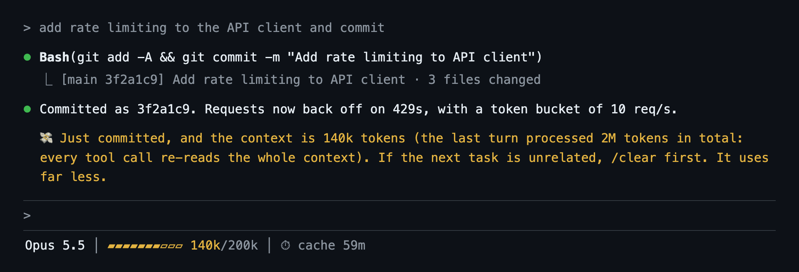

# context-nudge

[繁體中文](README.zh-TW.md)

**Use less of your Claude Code limits by starting fresh sessions at the right moment.**

The longer a session gets, the more every turn costs, because Claude re-reads the whole conversation on every tool call. context-nudge watches for the moments when a fresh session would save the most and tells you, in one line, right inside Claude Code:



Works with Pro and Max plans and with pay-as-you-go API keys. Reminders in English, 繁體中文, 简体中文, 日本語, and 한국어.

## Before you install

You need:

- **Claude Code in the terminal** (the `claude` command). You use it to install the plugin. Plugins can't be installed from the VS Code panel: `/plugin` there says it isn't available. Run the install commands below in a terminal instead.
- **`jq`**, which the reminders use. macOS 15 and later include it. Otherwise: `brew install jq` (macOS) or `sudo apt install jq` (Debian/Ubuntu). Check with `jq --version`.
- **`python3`** (optional), only for `/context-nudge:report`. Check with `python3 --version`.

## Install

**1. In a terminal, run:**

```bash
claude plugin marketplace add OWNER/context-nudge
claude plugin install context-nudge@context-nudge
```

You should see `✔ Successfully installed plugin: context-nudge@context-nudge`. The note about "userConfig options not yet set" is normal: every option has a default.

If you're already inside Claude Code in the terminal, you can type `/plugin marketplace add OWNER/context-nudge` and `/plugin install context-nudge@context-nudge` there instead.

**2. Restart Claude Code.** Close it and start a new session. Plugins load when a session starts.

**3. Check that it works.** In the new session, type:

```
/context-nudge:report
```

You get a short report on your last 30 days: where your usage went and how much the reminders would have saved. If you see it, the plugin is installed. (Needs `python3`. Without it, run `claude plugin list` in the terminal and look for `context-nudge@context-nudge` with `✔ enabled`.)

**4. (Optional) Add the status line.** Type `/context-nudge:setup-statusline` and Claude sets it up for you. See [Status line](#status-line).

## What you'll see, and what to do

Nothing at all while sessions are short. You only hear from the plugin when a fresh session would actually save something.

| You see | When | What to do |
| --- | --- | --- |
| 💸 **Just committed / pushed / PR is out**, and the context is … | A turn ends with a successful `git commit`, `git push`, `gh pr create`, or `npm publish`, and the context is over 100k tokens | Starting something unrelated? Type `/clear`. Continuing the same work? Ignore it. |
| 💸 **Context is at …k tokens** | The context passes 200k tokens, even mid-task | Done with the task: `/clear`. Still working, but the early conversation no longer matters: `/compact`. |
| 🔄 **Model switched (… → …)** | You send a message after `/model` switched to a different model. The new model has no cache of this conversation. Needs the status line. | This message already re-loaded the context. If your question is unrelated, `/clear` before switching next time. |
| ⏳ **… since the last turn, so the prompt cache has expired** | You send a message after being away longer than the cache lasts (usually 1 hour) | This message already re-loaded the context. If your question is unrelated to the session, `/clear` before asking next time. |

After a reminder, the plugin stays quiet until the context grows another 50k tokens, so it doesn't repeat itself every turn. `/compact` resets the count.

What the commands do:

- `/clear` starts a fresh, empty session. Use it when the next task doesn't need what came before.
- `/compact` summarizes the conversation so far and continues from the summary. Use it when you're mid-task but the conversation has grown long.

## Commands

| Command | What it does |
| --- | --- |
| `/context-nudge:report` | Replays your own history from the last 30 days: where your usage goes, how much following the reminders would save, how often you'd be reminded, and which sessions used the most. `/context-nudge:report 7` for the last 7 days, `/context-nudge:report 0` for everything. Runs locally. |
| `/context-nudge:setup-statusline` | Installs the status line. If you already have one, Claude asks whether to replace it or show both. |

## Status line

```
Opus 5.5 │ ▰▰▰▰▰▰▰▱▱▱ 140k/200k │ ⏱ cache 52m
Opus 5.5 │ ▰▰▰▰▰▰▰▱▱▱ 140k/200k │ ❄ cache cold
```

- `▰▰▰▰▰▰▰▱▱▱ 140k/200k` is the current context size, filling toward the `remind_always` threshold: green below 100k, yellow from 100k, red from 200k.
- `⏱ cache 52m` is how long until the prompt cache expires.
- With `unit: usd`, the session cost is added at the end. `≥$3.42` means some responses used a model not in the price table, so the real cost is higher.
- `❄ cache cold (model switched)` appears right after `/model`, because the new model has no cache of this conversation yet.
- `❄ cache cold` appears once the prompt cache has expired. It's the only warning you can see *before* you send a message, which is when it's still useful.

Run `/context-nudge:setup-statusline` once to set it up. It updates together with the plugin and uses the same [settings](#settings) as the reminders. The status line shows in Claude Code in the terminal. If you haven't set it up, the plugin mentions it once when a terminal session starts.

The bar fills toward `remind_always` (200k by default), not toward the model's context window. Even with a 1M-token window, every turn re-sends the whole context, so the cost grows with its size.

## Settings

Every option has a sensible default, so you don't have to change anything. To see the current values, run in a terminal:

```bash
claude plugin configure context-nudge@context-nudge
```

To change them, pipe in the ones you want to set. Options you leave out keep their values:

```bash
echo '{"language": "ja", "remind_always": "250000"}' | claude plugin configure context-nudge@context-nudge --values-stdin
```

Inside Claude Code you can also use `/plugin configure context-nudge@context-nudge`. **Restart Claude Code afterwards** for the change to apply.

| Option | Default | What it means |
| --- | --- | --- |
| `language` | `auto` | `en`, `zh-TW`, `zh-CN`, `ja`, `ko`, or `auto` |
| `unit` | `tokens` | `tokens`, or `usd` to see estimated cost at API prices (for pay-as-you-go API users) |
| `remind_at_breakpoint` | `100000` | From this context size, a commit, push, or PR triggers a reminder |
| `remind_always` | `200000` | From this context size, you're reminded even mid-task |
| `remind_step` | `50000` | After a reminder, stay quiet until the context grows this much |
| `idle_min_tokens` | `30000` | Only warn about an expired cache when the context is at least this big |

Reminders too frequent? Raise `remind_at_breakpoint` and `remind_always`. `/context-nudge:report` shows how often you'd be reminded with your current settings, and Claude can re-run it with other values so you can compare.

With `language` set to `auto`, the plugin follows your locale (`LC_ALL`, `LC_MESSAGES`, then `LANG`). `zh_TW`, `zh_HK`, `zh_MO`, and `zh-Hant` get Traditional Chinese; other `zh` locales get Simplified Chinese; `ja` gets Japanese; `ko` gets Korean; anything else gets English. When no locale is set, which is common on macOS for apps started from the Dock or VS Code, it uses the macOS system language. If you still see the wrong language, set `language` explicitly.

## Update and uninstall

Update:

```bash
claude plugin marketplace update context-nudge
claude plugin update context-nudge@context-nudge
```

Then restart Claude Code. The status line picks up the new version after your next message. If you set up the status line before this version, run `/context-nudge:setup-statusline` once more so it stays current from then on.

Uninstall:

```bash
claude plugin uninstall context-nudge@context-nudge
```

If you installed the status line, also remove the `statusLine` entry from `~/.claude/settings.json` and delete the `~/.claude/context-nudge` folder.

## Troubleshooting

**`/plugin isn't available in this environment`.** You're in the VS Code panel. Install from a terminal with the `claude plugin …` commands above.

**`claude: command not found`.** Claude Code isn't installed for the terminal. Install it by following the official Claude Code setup guide, then run the install commands again.

**I never see a reminder.** That's expected while your sessions stay under 100k tokens. To check it's working, temporarily set `remind_always` to `1000` (see [Settings](#settings)), restart Claude Code, ask anything, and you should see a reminder after the reply. Then set it back to `200000`. If nothing appears, check that `jq --version` works and that `claude plugin list` shows the plugin as enabled.

**Reminders are in the wrong language.** Set `language` explicitly (see [Settings](#settings)) and restart Claude Code. The status line uses the same setting.

**The report says it used the default thresholds.** That's normal right after installing. Once the plugin has sent a reminder check (after any reply), the report uses your settings.

## Does it actually help?

We replayed 16 real sessions (about $250 of usage at API prices) to see where the usage went and what following the reminders would have changed:

| Where the usage went | Share |
| --- | --- |
| Re-reading the context from cache | 55% |
| Output | 17% |
| Re-writing the cache after it expired | 16% |
| Writing new content to the cache | 12% |

With the default thresholds, following every reminder would have cut usage by **about 48–60%**: 48% if each `/clear` then needs 80k tokens re-read to continue, 60% if it needs none. That came with a reminder about once every 8 turns. Treat it as a ceiling: it assumes you follow every reminder and that the next task doesn't need the old context. Most of the savings came from a few marathon sessions (one 900k-token session was 40% of all usage). If you already `/clear` often, expect much less.

That's one person's history. Run `/context-nudge:report` to see yours.

## Good to know

- **Everything runs on your machine.** The plugin reads the transcripts Claude Code already saves locally. Nothing is sent anywhere.
- **How Pro/Max limits count tokens isn't published**, so the plugin doesn't show "% of your limit". It shows tokens. Cached reads are much cheaper than other tokens on the API and probably count for less against limits too, so a big "processed" number overstates the impact somewhat. Re-writes after the cache expires are the expensive part.
- **`unit: usd` uses API list prices** from [`scripts/prices.json`](scripts/prices.json) (updated 2026-11-03). Models not in the table are shown in tokens. If only some responses used such a model, the cost is shown as a lower bound (`≥$3.42`).
- **Subagents** run in their own transcripts and aren't counted.
- **The numbers can trail by one response.** Claude Code writes the transcript asynchronously, so the very last response of a turn is sometimes missing when the plugin reads it.

## License

MIT
